# Trascrivi Audio – Guida

Trascrive file audio in testo **sul tuo Mac**, senza inviarli online. Ti indica le parole da
ricontrollare e ti permette di correggerle ascoltando il punto esatto dell'audio. Ogni
trascrizione è un **progetto**, con una cartella che contiene tutti i suoi file.

**In questa guida:**

1. Installare Trascrivi Audio
2. Creare un nuovo progetto
3. Aprire un progetto esistente
4. Il menu principale e la disinstallazione
5. Dettagli sul funzionamento

> Le immagini delle finestre di macOS sono **illustrazioni**: sul tuo Mac l'aspetto può essere
> leggermente diverso. In rosso è indicato **dove cliccare**.

## 1. Installare Trascrivi Audio

Serve una connessione a internet. L'installazione si fa **una volta sola** e scarica circa
5 GB: a seconda della connessione può richiedere da 15 minuti a più di un'ora.

### Passo 1 – Apri lo ZIP

Fai **doppio clic** su **TrascriviAudio.zip** (di solito è nella cartella **Download**).
Il Mac crea la cartella **Trascrivi Audio**.

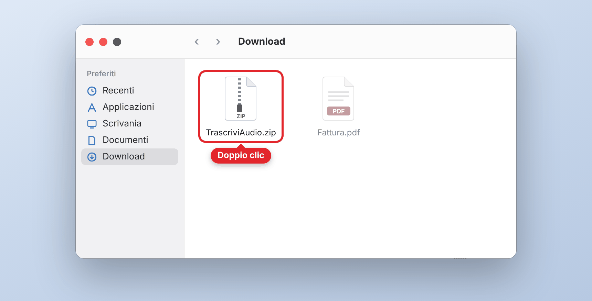{width=88%}\

### Passo 2 – Apri l'app

Apri la cartella **Trascrivi Audio** e fai **doppio clic** sull'icona blu **Trascrivi Audio**.

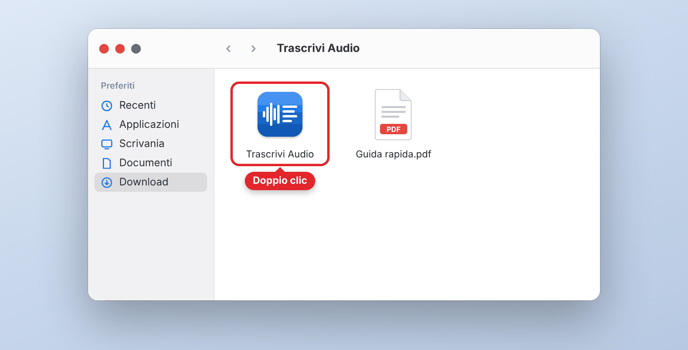{width=88%}\

### Passo 3 – macOS blocca l'app: clicca «Fine»

La prima volta macOS mostra questo avviso, perché l'app non è firmata da Apple. È normale:
clicca **Fine** (non «Sposta nel Cestino»).

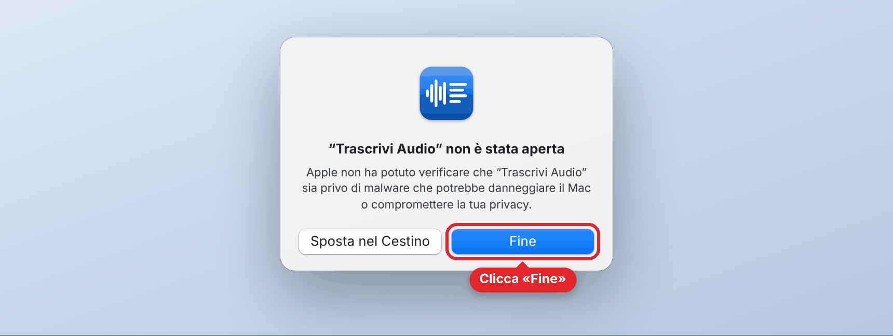{width=88%}\

### Passo 4 – Sblocca l'app in Impostazioni di Sistema

1. Apri il **menu Apple** (la mela in alto a sinistra) → **Impostazioni di Sistema**.
2. Nella colonna a sinistra clicca **Privacy e sicurezza**.
3. Scorri verso il basso fino alla sezione **Sicurezza** e clicca **Apri comunque**, accanto alla
   scritta «“Trascrivi Audio” è stato bloccato per proteggere il Mac».

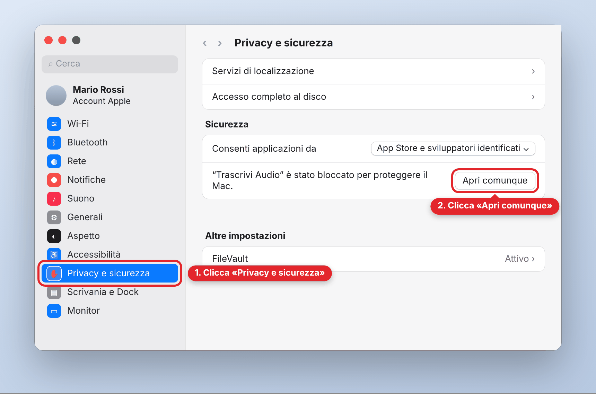{width=88%}\

> Il pulsante **Apri comunque** compare per circa un'ora dopo il passo 3. Se non lo vedi,
> rifai doppio clic sull'app (passo 2) e torna qui.

### Passo 5 – Conferma con la password

Clicca **Apri comunque** nella finestra che compare, poi inserisci la **password del Mac**
(o usa Touch ID) e clicca **Modifica impostazioni**. Questo sblocco si fa una volta sola.

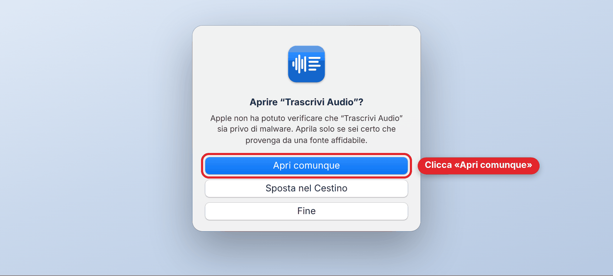{width=88%}\

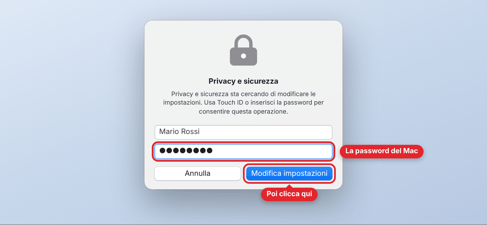{width=88%}\

### Passo 6 – Lascia lavorare il programma

Da qui in poi **fa tutto da solo**, senza domande:

- si copia nella cartella **Applicazioni**;
- apre una finestra del **Terminale** che mostra l'avanzamento: **lasciala aperta**;
- scarica e installa Python (solo se manca), Whisper e i modelli di trascrizione.

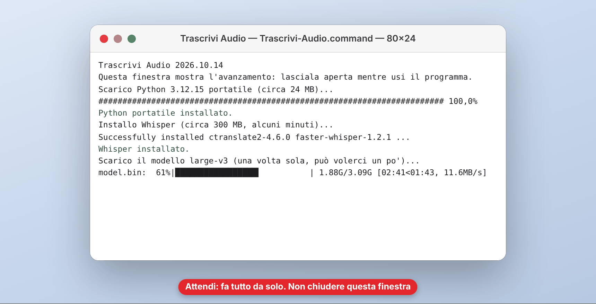{width=88%}\

Durante l'installazione o il primo utilizzo, macOS può chiederti il permesso di accedere a
cartelle come **Documenti**, **Scrivania** o **Download**: clicca **Consenti**.

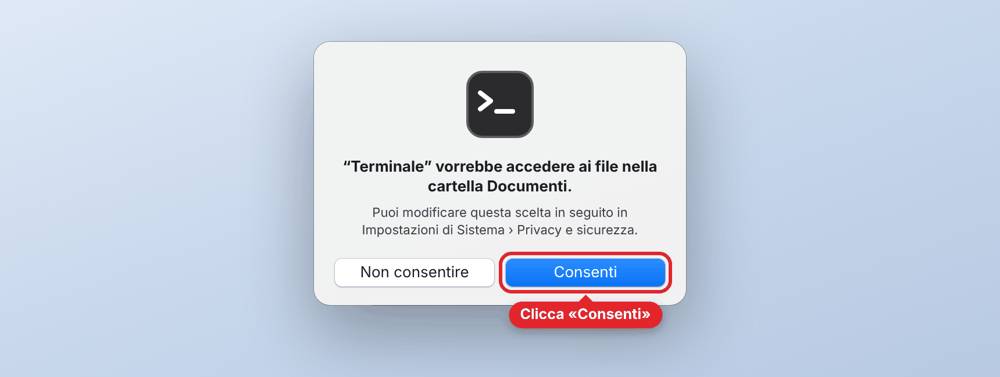{width=88%}\

### Passo 7 – Installazione completata

Quando compare questo messaggio clicca **OK**: si apre il **menu principale** (vedi il punto 2).

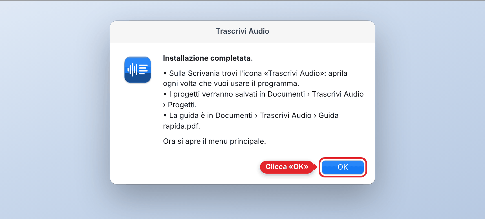{width=88%}\

Sulla **Scrivania** trovi l'icona **Trascrivi Audio**: d'ora in poi apri il programma con un
**doppio clic su questa icona**. Lo ZIP e la cartella scaricata non servono più: puoi cancellarli.

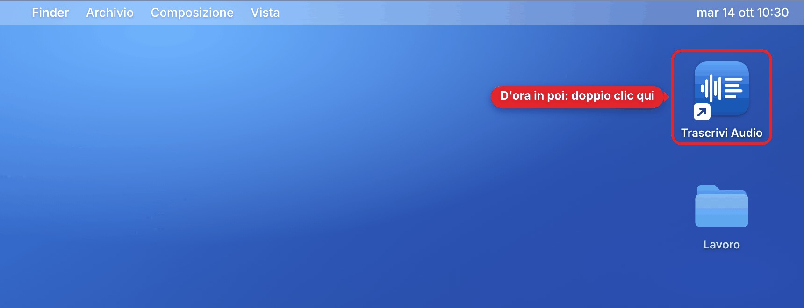{width=88%}\

## 2. Creare un nuovo progetto

Ogni trascrizione è un **progetto**: ha un nome scelto da te e una cartella con tutti i suoi file.

### Passo 1 – Scegli «Nuovo progetto»

Fai doppio clic sull'icona **Trascrivi Audio** sulla Scrivania. Si apre anche la finestra del
Terminale: lasciala aperta, mostra l'avanzamento. Nel menu seleziona **Nuovo progetto** e
clicca **Avanti**.

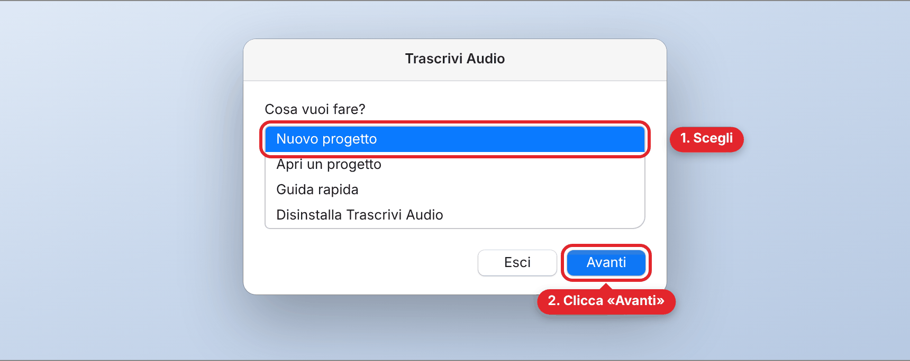{width=88%}\

### Passo 2 – Dai un nome al progetto

Scrivi il nome, per esempio «Intervista Rossi», e clicca **Avanti**. Il nome deve essere diverso
da quello degli altri progetti.

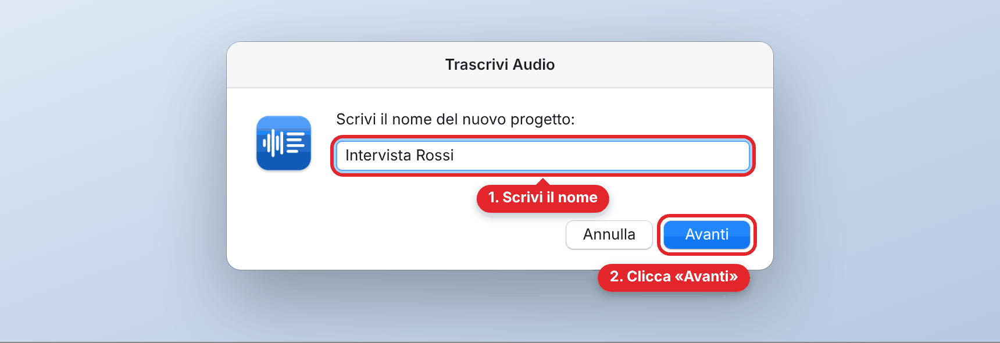{width=88%}\

### Passo 3 – Scegli il file audio

Seleziona il file audio (o video) da trascrivere e clicca **Scegli**. Il file viene **copiato**
nel progetto: l'originale resta dov'è.

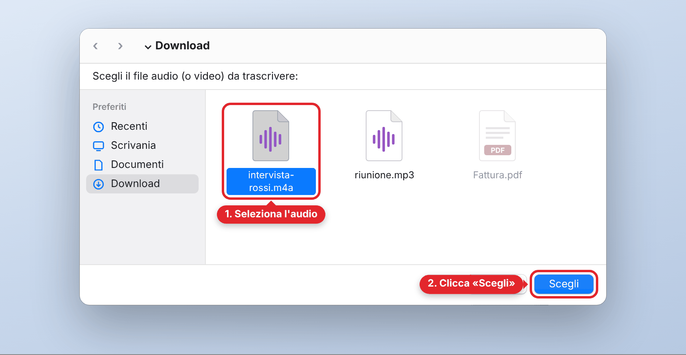{width=88%}\

### Passo 4 – Attendi la trascrizione

Nella finestra del Terminale vedi a che punto è. Conta da 1 a 3 volte la durata dell'audio:
per un'ora di registrazione possono servire 2-3 ore. Puoi usare il Mac per altro nel frattempo.

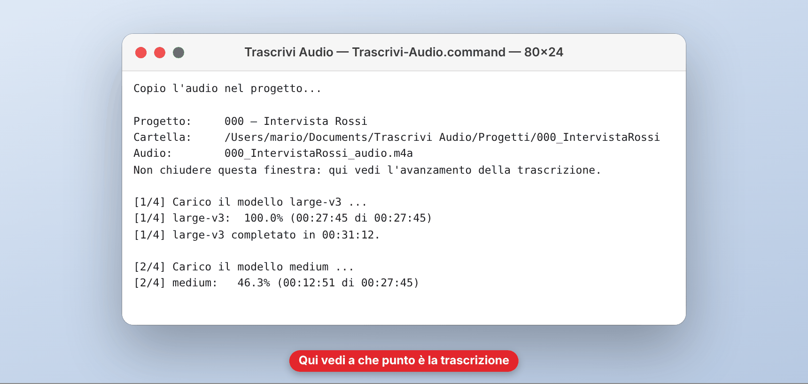{width=88%}\

### Passo 5 – Trascrizione completata

Un messaggio ti dice quante parole sono da ricontrollare. Clicca **OK**: si apre nel browser
la **schermata di controllo**. Se non ci sono parole dubbie, si apre direttamente la trascrizione.

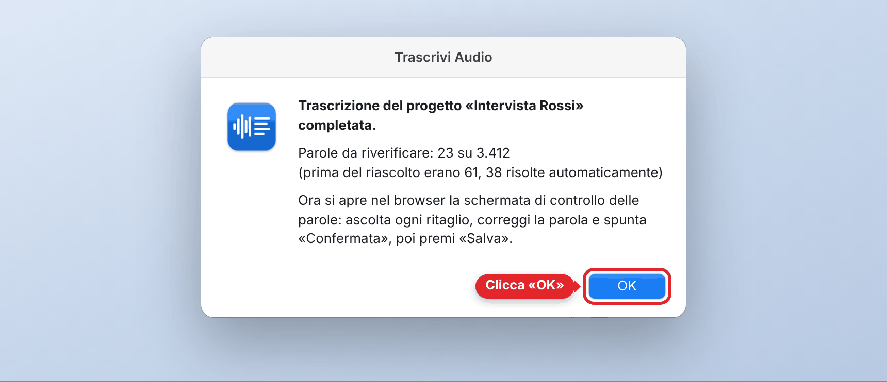{width=88%}\

### Passo 6 – Controlla le parole dubbie

Per ogni parola:

1. **ascolta** il ritaglio (▶): circa 3 secondi prima e dopo la parola;
2. se la parola è sbagliata, **scrivi quella giusta** nel campo (per cancellarla, svuota il campo);
3. spunta **Confermata** (oppure premi **Invio**): il campo si blocca.

Alla fine, 4. clicca **Salva**: la trascrizione corretta viene aggiornata e il programma
ricorda le tue scelte per le trascrizioni future.

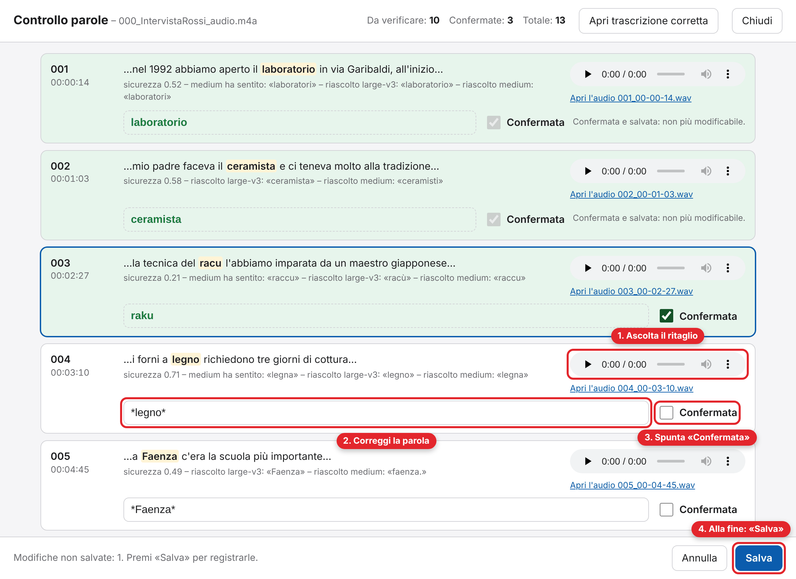{width=100%}\

Non serve finire in una volta. Quando vuoi smettere clicca **Salva** e poi **Chiudi** (in alto a
destra): torni al menu principale. Riprendi quando vuoi con **Apri un progetto** (punto 3).

### Dove trovi i file

Tutto il progetto è in **Documenti › Trascrivi Audio › Progetti**, in una cartella con numero e
nome (es. `000_IntervistaRossi`). Il testo finale è il file che finisce con
**`_trascrizione_corretta.txt`**.

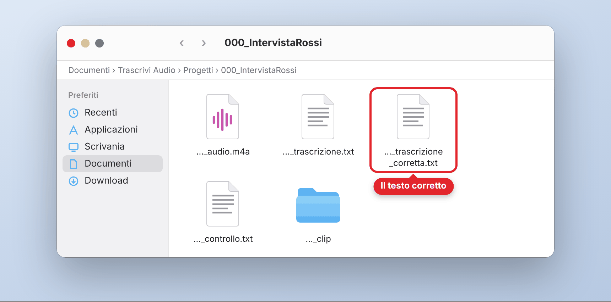{width=88%}\

## 3. Aprire un progetto esistente

### Passo 1 – Scegli «Apri un progetto»

Fai doppio clic sull'icona **Trascrivi Audio**, seleziona **Apri un progetto** e clicca **Avanti**.

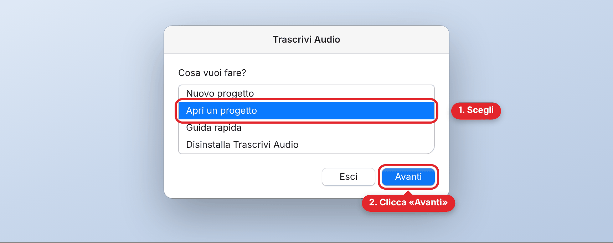{width=88%}\

### Passo 2 – Scegli il progetto

Compare la lista dei progetti: seleziona quello che ti serve e clicca **Avanti**.

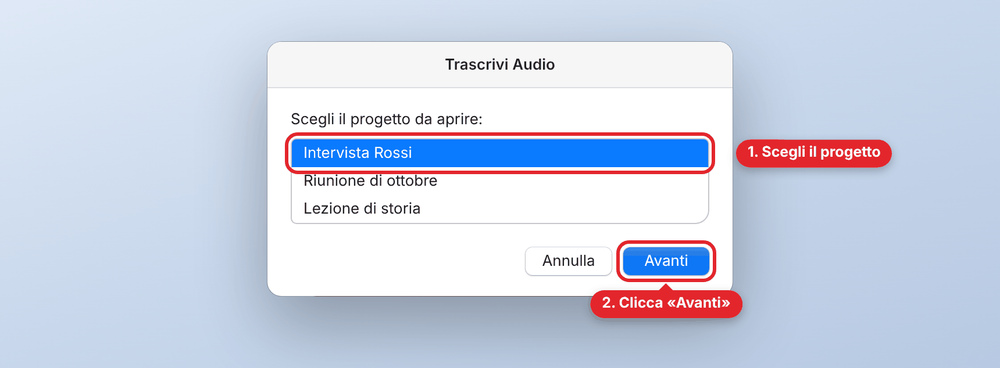{width=88%}\

### Passo 3 – Scegli cosa fare

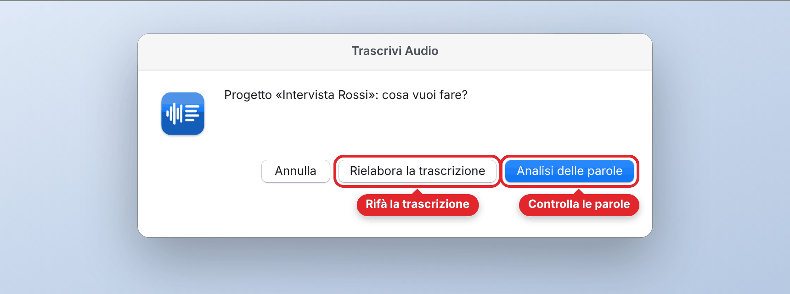{width=88%}\

- **Analisi delle parole**: riapre la schermata di controllo, dalla prima pagina con parole
  ancora da verificare. Le parole già confermate sono verdi e bloccate.
- **Rielabora la trascrizione**: rifà la trascrizione da capo con l'audio del progetto. Prima
  chiede conferma, perché le correzioni fatte in quel progetto si perdono (il tuo dizionario
  personale resta e viene usato).

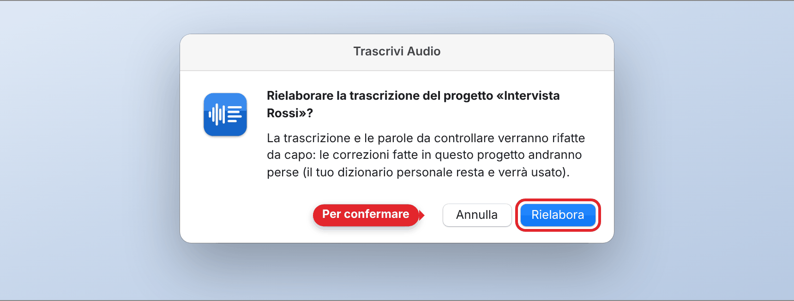{width=88%}\

> Se un progetto non ha ancora una trascrizione completa (per esempio perché era stata
> interrotta), aprendolo la trascrizione riparte da sola. Se manca l'audio, ti viene chiesto.

## 4. Il menu principale e la disinstallazione

Ogni volta che apri **Trascrivi Audio** compare il menu principale. Dopo ogni operazione ci torni.

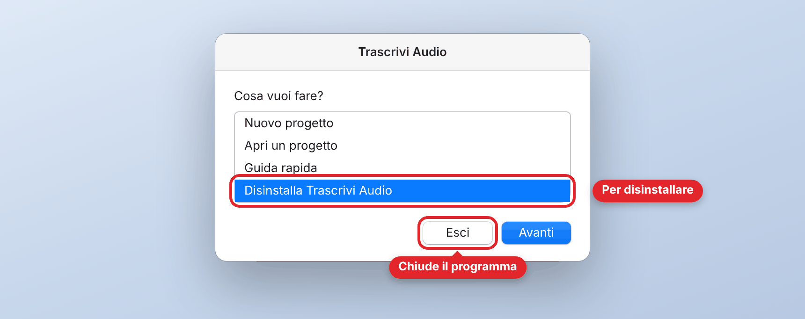{width=88%}\

| Voce del menu | Cosa fa |
|---|---|
| **Nuovo progetto** | crea un progetto e trascrive un file audio (punto 2) |
| **Apri un progetto** | riapre un progetto: analisi delle parole o nuova trascrizione (punto 3) |
| **Guida rapida** | apre questa guida |
| **Disinstalla Trascrivi Audio** | toglie il programma dal Mac (vedi sotto) |
| **Esci** | chiude il programma; poi puoi chiudere la finestra del Terminale |

### Disinstallare

Nel menu seleziona **Disinstalla Trascrivi Audio** e clicca **Avanti**. Poi scegli:

- **Conserva i progetti**: toglie il programma ma lascia audio e trascrizioni in
  Documenti › Trascrivi Audio;
- **Cancella anche i progetti**: toglie tutto. Prima chiede ancora una conferma.

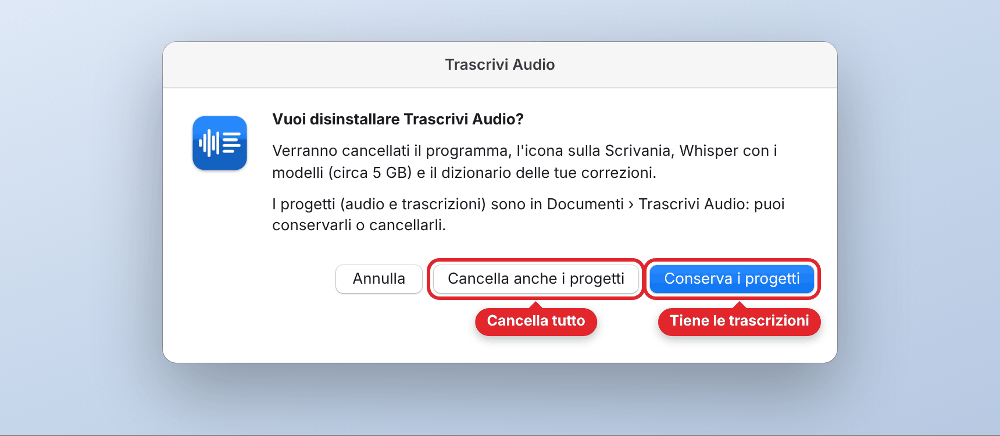{width=88%}\

In entrambi i casi vengono tolti l'app da Applicazioni, l'icona sulla Scrivania, Whisper, i
modelli e il dizionario delle tue correzioni.

## 5. Dettagli sul funzionamento

### 5.1 Cosa fa l'installazione

| Cosa | Dove | Note |
|---|---|---|
| L'app | Applicazioni › Trascrivi Audio | si copia lì al primo avvio e lavora sempre da lì |
| Python | Libreria › Application Support › TrascriviAudio › python | usa il Python del Mac se c'è (dalla 3.10 alla 3.13, le versioni adatte a Whisper); altrimenti scarica un Python «portatile» (circa 24 MB), senza password e senza toccare il sistema. Il file scaricato viene verificato con la sua impronta di sicurezza (SHA-256) |
| Whisper | Libreria › Application Support › TrascriviAudio | circa 300 MB |
| Modelli large-v3 e medium | stessa cartella | circa 4,5 GB, scaricati una volta sola |
| Icona sulla Scrivania | Scrivania | collegamento all'app in Applicazioni |
| Cartella dei progetti | Documenti › Trascrivi Audio | con una copia di questa guida |
| Versioni precedenti | — | se ce ne sono, i loro file vengono tolti e i progetti spostati in Documenti |

**L'audio non viene mai inviato online** dal programma: internet serve solo per scaricare, una
volta, Python (se manca), Whisper e i modelli. Il programma lavora sempre dalla copia in
Applicazioni, dentro una finestra del Terminale che mostra cosa sta facendo.

**Attenzione a iCloud:** se sul Mac è attiva l'opzione di iCloud Drive **«Cartelle Scrivania e
Documenti»**, macOS carica su iCloud tutto quello che c'è in Documenti, quindi anche i progetti con
l'audio. Per tenerli solo sul Mac, disattivala in Impostazioni di Sistema › *il tuo nome* › iCloud ›
iCloud Drive (i documenti già su iCloud restano su iCloud Drive).

### 5.2 I progetti e i loro file

Ogni progetto ha un **nome** scelto da te e un **numero** da 000 a 999 assegnato dal programma.
La sua cartella si chiama con numero e nome senza spazi (es. `000_IntervistaRossi`) e contiene:

| File | Cosa contiene |
|---|---|
| `…_audio.m4a` (o .mp3, .wav…) | una **copia** del file audio sorgente |
| `…_trascrizione.txt` | la trascrizione automatica |
| `…_trascrizione_corretta.txt` | la trascrizione con le tue correzioni, aggiornata a ogni salvataggio |
| `…_controllo.txt` | il file delle parole dubbie, letto e aggiornato dalla schermata di controllo |
| `…_dati.json` | dati tecnici della trascrizione: non spostarlo e non rinominarlo |
| `…_clip` (cartella) | un ritaglio audio per ogni parola dubbia |

Nella cartella **Progetti** ci sono anche due file gestiti dal programma:

- `elenco-progetti.json`, il **file generale**: per ogni progetto numero, nome, cartella, stato e
  lista di tutti i suoi file;
- `progetto-in-corso.json`, file **temporaneo** con il progetto su cui stai lavorando: viene
  cancellato quando l'operazione finisce.

Ogni operazione lavora **solo sui file del progetto aperto**.

### 5.3 Come funziona la trascrizione

Il programma usa **Whisper**, un sistema di riconoscimento vocale che lavora solo sul tuo Mac.
Ogni audio viene ascoltato più volte, da due modelli diversi, per scoprire dove la
trascrizione potrebbe essere sbagliata.

| Ascolto | Cosa succede |
|---|---|
| 1° – modello **large-v3** | trascrive tutto l'audio e dà a ogni parola un punteggio di **sicurezza** |
| 2° – modello **medium** | ritrascrive tutto l'audio, come seconda opinione |
| Confronto | una parola è **dubbia** se large-v3 non ne è sicuro **oppure** se i due modelli hanno sentito cose diverse |
| 3° – riascolto con large-v3 | ritaglia solo le frasi con parole dubbie e le fa riascoltare. Se ora sente la stessa cosa di medium, il dubbio è risolto |
| 4° – riascolto con medium | dove ancora non coincidono, medium riascolta. Se coincide con il riascolto di large-v3, il dubbio è risolto; altrimenti la parola **resta da verificare** |
| Il tuo dizionario | quando una parola è di nuovo dubbia: se l'avevi corretta viene sistemata da sola, se l'avevi confermata non viene più segnata. Le parole brevi come e/è, a/ha, o/ho e le coppie come anno/hanno restano invece da controllare, perché dipendono dalla frase. Le parole di cui Whisper è sicuro non vengono mai cambiate |

Per ogni parola che resta dubbia, il programma salva un **ritaglio audio** con 3 secondi prima e
3 dopo. Nei file di testo le parole dubbie sono segnate così:

- `*parola*`: da controllare;
- `**parola**`: da controllare per prima, perché i dubbi sono due (sicurezza bassa e modelli in disaccordo).

**Tempi:** da 1 a 3 volte la durata dell'audio, a seconda del Mac (più veloce con i chip Apple M1
e successivi). Mentre il programma lavora il Mac non va in stop da solo; se chiudi il coperchio del
portatile, però, si ferma anche la trascrizione.

### 5.4 La schermata di controllo

La schermata si apre nel **browser** (Safari o Chrome) ma funziona **solo sul tuo Mac**: non usa
internet e non è raggiungibile da altri computer.

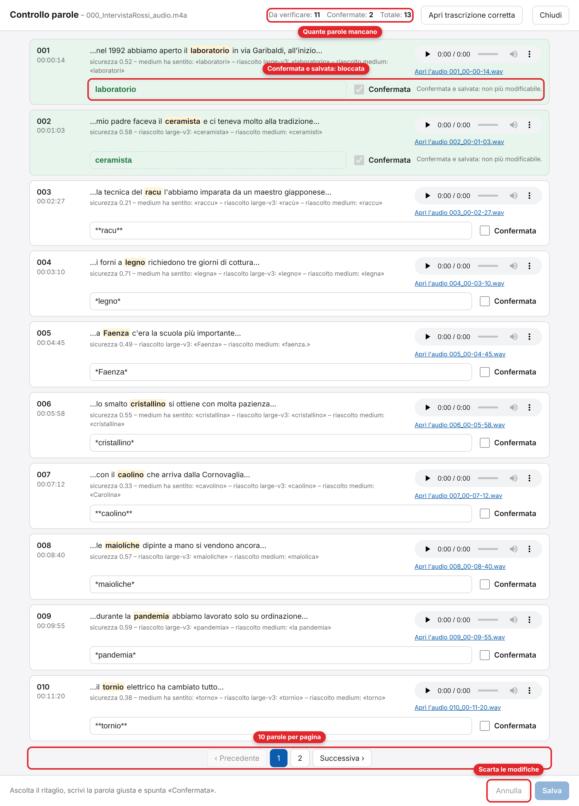{width=78%}\

| Parte | A cosa serve |
|---|---|
| In alto | nome dell'audio, conteggi (da verificare, confermate, totale), **Apri trascrizione corretta**, **Chiudi** |
| Ogni riga | numero e orario, frase con la parola evidenziata in giallo, cosa hanno sentito i vari ascolti, lettore del ritaglio e link «Apri l'audio», campo della parola, casella **Confermata** |
| In fondo | numeri di pagina (10 parole per pagina; ✓ = pagina completata), **Salva** e **Annulla** |

| Pulsante | Cosa fa |
|---|---|
| **Salva** | scrive le modifiche nel file delle parole dubbie, aggiorna la **trascrizione corretta**, registra le parole nel tuo **dizionario personale** (correzioni e conferme) e salva gli esempi audio. Poi **ricarica il file**: le parole confermate restano bloccate per sempre |
| **Annulla** | scarta le modifiche non ancora salvate e mostra di nuovo il contenuto del file |
| **Chiudi** | chiude la schermata e torna al menu principale. Se ci sono modifiche non salvate, avvisa. Se chiudi la scheda del browser senza «Chiudi», dopo pochi secondi si torna comunque al menu |

- Una parola modificata ma **non** confermata viene salvata come bozza: resta tra asterischi e
  potrai confermarla più tardi.
- Il riquadro blu indica una riga modificata e non ancora salvata.
- **Cosa vuol dire "registrare" una parola:** Whisper non viene riaddestrato, ma il programma
  ricorda le tue scelte nel **dizionario personale**, comune a tutti i progetti. Nelle trascrizioni
  successive le parole corrette vengono suggerite a Whisper e, dove sono di nuovo dubbie,
  sistemate da sole (tranne le parole brevi come e/è, che dipendono dalla frase); quelle
  confermate non vengono più segnate.

### 5.5 Aggiornare il programma

Scarica il nuovo **TrascriviAudio.zip**, aprilo e fai doppio clic sull'app nella cartella estratta
(come ai passi 1 e 2 dell'installazione). L'app sostituisce quella in Applicazioni e compare
«Aggiornamento completato». Progetti, dizionario, Whisper e modelli restano. Se macOS blocca di
nuovo l'app, ripeti i passi 3-5 dell'installazione.

### 5.6 Problemi frequenti

| Problema | Soluzione |
|---|---|
| «“Trascrivi Audio” non è stata aperta» | segui i passi 3-5 dell'installazione |
| Non trovo «Apri comunque» | compare per circa un'ora dopo il tentativo di apertura: rifai doppio clic sull'app e torna in Privacy e sicurezza |
| «Per aprire "Trascrivi Audio" devi installare Rosetta» | sui Mac con chip Apple può comparire al primo avvio: clicca **Installa** (serve la password del Mac), poi riapri Trascrivi Audio |
| «Non riesco a creare la cartella dei progetti in Documenti» o «Non ho il permesso di leggere il file» | macOS non permette al Terminale di usare quella cartella: in Impostazioni di Sistema › **Privacy e sicurezza** › **File e cartelle** › **Terminale** attiva la cartella (Documenti, Download o Volumi rimovibili) e riprova |
| «Download di Python non riuscito» o «non è integro» | controlla la connessione a internet e riapri Trascrivi Audio |
| L'icona sulla Scrivania non c'è più | apri Trascrivi Audio dalla cartella **Applicazioni**. Per rimettere l'icona, trascina l'app sulla Scrivania tenendo premuti i tasti ⌥ e ⌘ |
| Ho chiuso la finestra del Terminale | il programma si interrompe: riaprilo dall'icona. Se stava trascrivendo, apri il progetto: la trascrizione riparte |
| «La cartella del progetto non esiste più» | se l'hai spostata o rinominata, rimettila in Documenti › Trascrivi Audio › Progetti con il nome originale; se l'hai cancellata, scegli **Togli dall'elenco** |
| «Trascrivi Audio è già aperto in un'altra finestra» | il programma si può aprire una volta sola: continua dalla finestra del Terminale già aperta (fai clic sull'icona del Terminale nel Dock) |
| «Il file … non è un audio leggibile» o «non contiene audio» | il file è rovinato, non è un audio o è un video senza audio: scegline un altro |
| «Nell'audio non è stato riconosciuto nessun parlato» | il file è muto o non è quello giusto: crea un nuovo progetto con il file giusto |
| «La trascrizione non è riuscita» | il programma torna al menu; il motivo è scritto nella finestra del Terminale. Puoi riprovare da **Apri un progetto** |
| La schermata di controllo non si apre | nella finestra del Terminale c'è l'indirizzo da copiare nel browser |
| L'audio di una riga non parte | usa il link «Apri l'audio» sotto il lettore |
| Una parola non deve più essere considerata confermata | cancella la sua riga da `dizionario.txt` (vedi 5.7) |
| Qualcosa va storto | copia il testo della finestra del Terminale e invialo a chi ti assiste |

### 5.7 Dove sono i dati

- **Programma:** Applicazioni › Trascrivi Audio.
- **Progetti e guida:** Documenti › Trascrivi Audio.
- **Dati del programma:** `~/Library/Application Support/TrascriviAudio` (nel Finder: menu
  Vai → Vai alla cartella…, poi incolla il percorso). Contiene:
  - `python/`, `venv/` e `modelli/`: Python, Whisper e i modelli;
  - `dizionario.txt`: le tue correzioni e conferme, una per riga («sbagliata → giusta»). Puoi
    modificarlo a mano (al posto di → puoi scrivere ->): le righe che cancelli non ricompaiono;
  - `esempi/`: gli audio corretti, con il testo giusto.

Per disinstallare usa la voce **Disinstalla Trascrivi Audio** del menu (punto 4): toglie tutto
da solo.
