# Trascrivi Audio per Windows – Guida

Trascrive file audio in testo **sul tuo computer**, senza inviarli online. Ti indica le parole
da ricontrollare e ti permette di correggerle ascoltando il punto esatto dell'audio. Ogni
trascrizione è un **progetto**, con una cartella che contiene tutti i suoi file.
Funziona con **Windows 11** (e Windows 10 aggiornato).

**In questa guida:**

1. Installare Trascrivi Audio
2. Creare un nuovo progetto
3. Aprire un progetto esistente
4. Il menu principale e la disinstallazione
5. Dettagli sul funzionamento

> Le immagini delle finestre di Windows sono **illustrazioni**: sul tuo computer l'aspetto può
> essere leggermente diverso. In rosso è indicato **dove cliccare**.

## 1. Installare Trascrivi Audio

Serve una connessione a internet. L'installazione si fa **una volta sola**, non chiede la password
di amministratore e scarica circa 5 GB: a seconda della connessione può richiedere da 15 minuti a
più di un'ora.

### Passo 1 – Estrai lo ZIP

Su Windows il doppio clic su uno ZIP lo apre senza estrarlo: per questo serve «Estrai tutto».
Nella cartella **Download** fai **clic con il tasto destro** su **TrascriviAudio-Windows.zip** e
scegli **Estrai tutto…**.

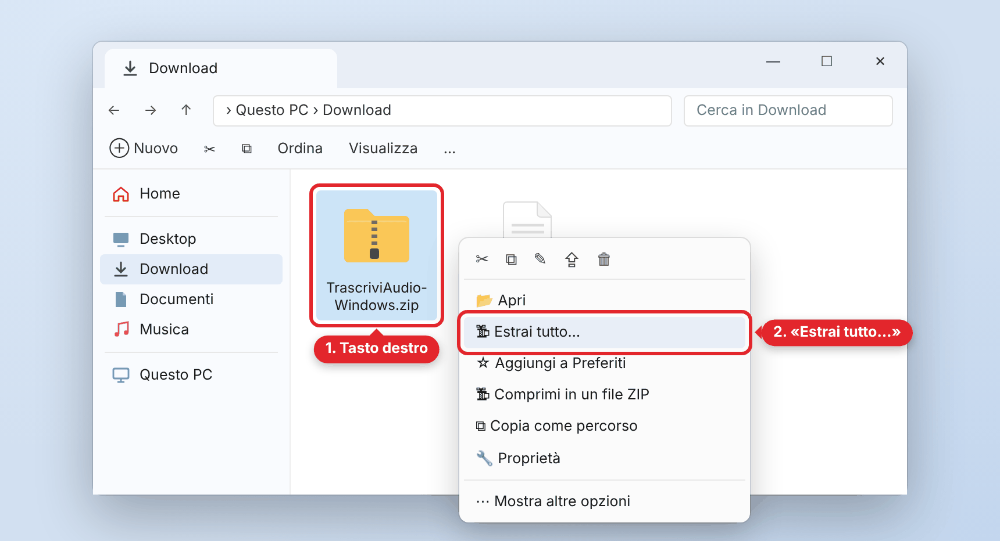{width=88%}\

Nella finestra che si apre clicca **Estrai**. Al termine si apre la cartella con i file estratti.

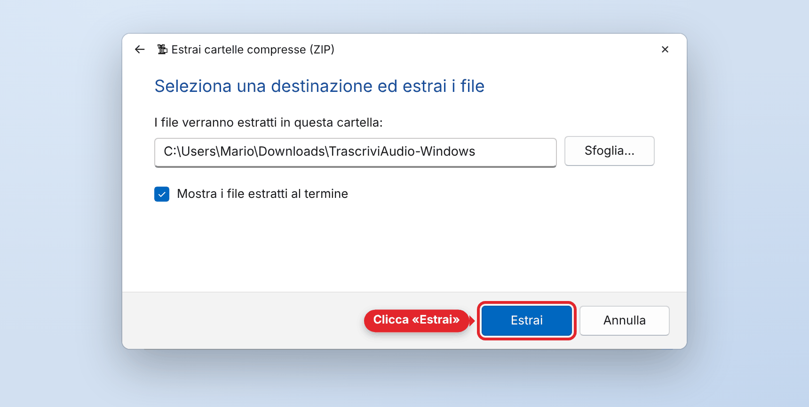{width=88%}\

### Passo 2 – Avvia l'installazione

Apri la cartella **Trascrivi Audio** e fai **doppio clic** su **Installa Trascrivi Audio**.

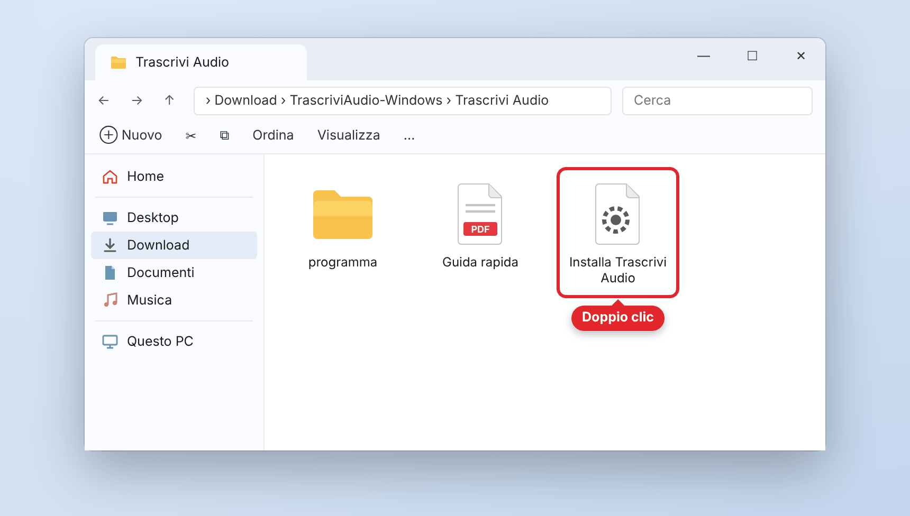{width=88%}\

### Passo 3 – Se Windows mostra un avviso

Il programma non è firmato digitalmente, quindi la prima volta Windows può mostrare un avviso.
È normale: si supera così.

**Se compare «Windows ha protetto il PC»** (SmartScreen): clicca **Ulteriori informazioni**…

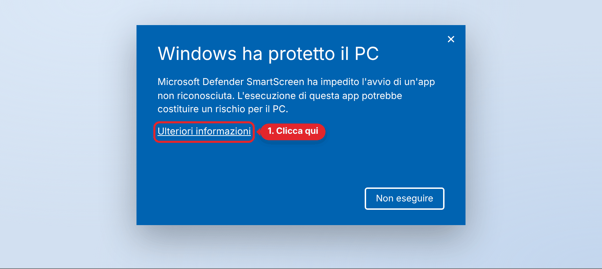{width=88%}\

…e poi **Esegui comunque**.

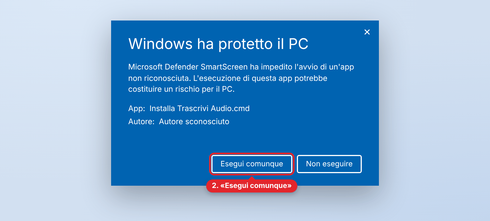{width=88%}\

**Se invece compare «Avviso di sicurezza»**: clicca **Esegui**.

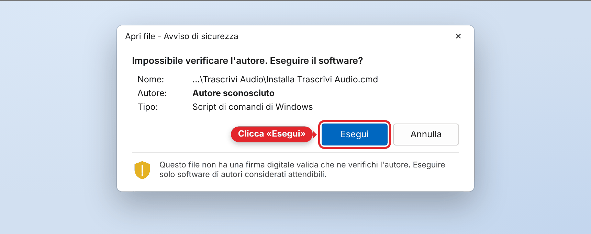{width=88%}\

> Per non vedere nessun avviso: **prima** di estrarre lo ZIP, fai tasto destro sullo ZIP →
> **Proprietà** → spunta **Annulla blocco** → **OK**, e poi estrai.

### Passo 4 – Lascia lavorare il programma

Da qui in poi **fa tutto da solo**, senza domande:

- si copia nella cartella dei programmi del tuo utente (`AppData\Local\Programs\Trascrivi Audio`);
- apre una finestra di **PowerShell** che mostra l'avanzamento: **lasciala aperta**;
- scarica e installa una copia di Python solo per il programma, Whisper e i modelli di trascrizione.

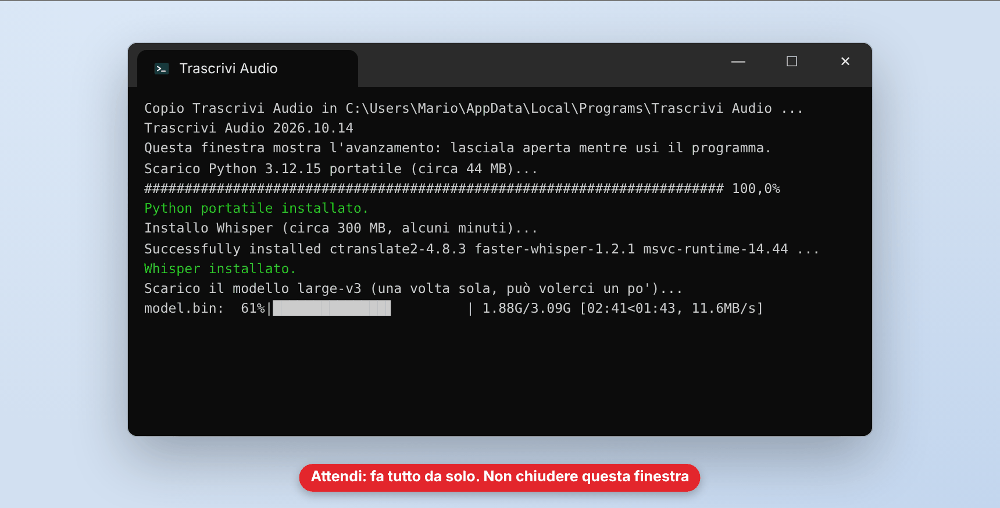{width=88%}\

### Passo 5 – Installazione completata

Quando compare questo messaggio clicca **OK**: si apre il **menu principale** (vedi il punto 2).
Il messaggio ti dice anche dove verranno salvati i progetti.

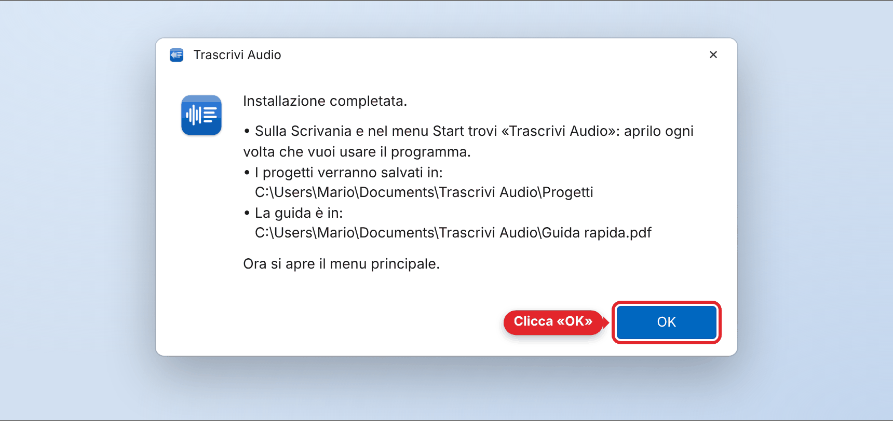{width=88%}\

Sulla **Scrivania** e nel **menu Start** trovi **Trascrivi Audio**: d'ora in poi apri il programma
con un **doppio clic su questa icona**. Lo ZIP e la cartella estratta non servono più: puoi
cancellarli.

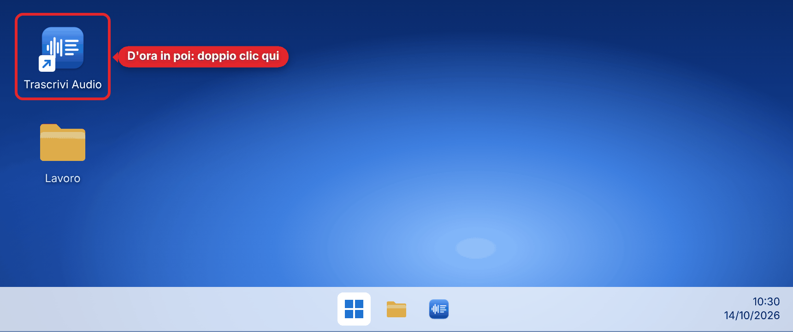{width=88%}\

## 2. Creare un nuovo progetto

Ogni trascrizione è un **progetto**: ha un nome scelto da te e una cartella con tutti i suoi file.

### Passo 1 – Scegli «Nuovo progetto»

Fai doppio clic sull'icona **Trascrivi Audio** sulla Scrivania. Si apre anche la finestra di
PowerShell: lasciala aperta, mostra l'avanzamento. Nel menu scegli **Nuovo progetto** e clicca
**Avanti**.

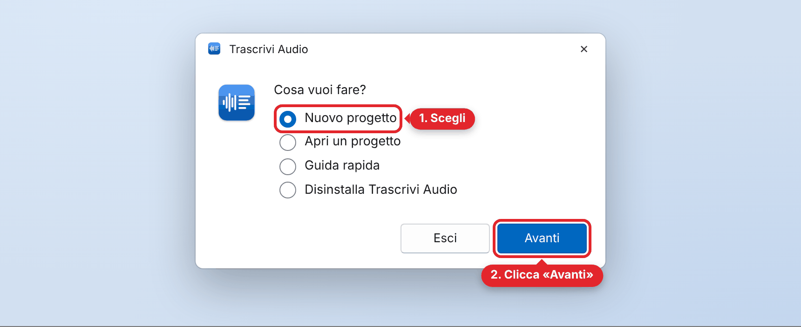{width=88%}\

### Passo 2 – Dai un nome al progetto

Scrivi il nome, per esempio «Intervista Rossi», e clicca **Avanti**. Il nome deve essere diverso
da quello degli altri progetti.

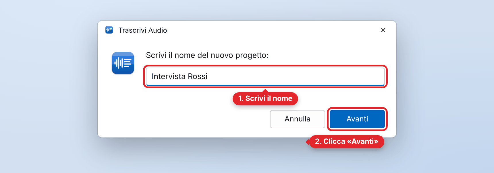{width=88%}\

### Passo 3 – Scegli il file audio

Seleziona il file audio (o video) da trascrivere e clicca **Apri**. Il file viene **copiato** nel
progetto: l'originale resta dov'è.

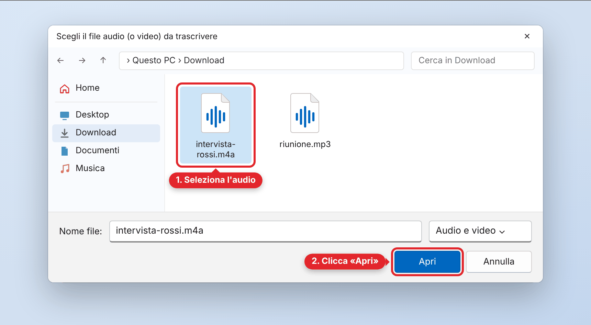{width=88%}\

### Passo 4 – Attendi la trascrizione

Nella finestra di PowerShell vedi a che punto è. Conta da 1 a 3 volte la durata dell'audio: per
un'ora di registrazione possono servire alcune ore, a seconda del computer. Puoi usare il
computer per altro nel frattempo.

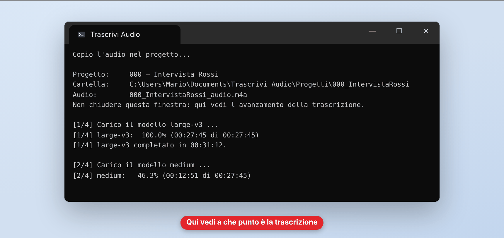{width=88%}\

### Passo 5 – Trascrizione completata

Un messaggio ti dice quante parole sono da ricontrollare. Clicca **OK**: si apre nel browser la
**schermata di controllo**. Se non ci sono parole dubbie, si apre direttamente la trascrizione.

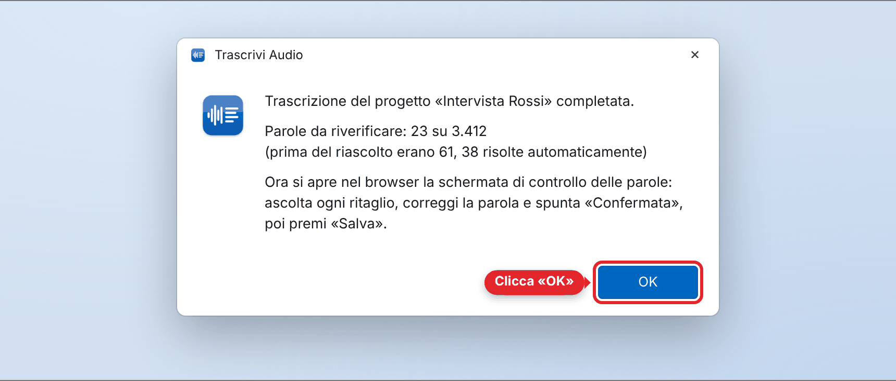{width=88%}\

### Passo 6 – Controlla le parole dubbie

Per ogni parola:

1. **ascolta** il ritaglio (▶): circa 3 secondi prima e dopo la parola;
2. se la parola è sbagliata, **scrivi quella giusta** nel campo (per cancellarla, svuota il campo);
3. spunta **Confermata** (oppure premi **Invio**): il campo si blocca.

Alla fine, 4. clicca **Salva**: la trascrizione corretta viene aggiornata e il programma ricorda
le tue scelte per le trascrizioni future.

{width=100%}\

Non serve finire in una volta. Quando vuoi smettere clicca **Salva** e poi **Chiudi** (in alto a
destra): torni al menu principale. Riprendi quando vuoi con **Apri un progetto** (punto 3).

### Dove trovi i file

Tutto il progetto è in **Documenti › Trascrivi Audio › Progetti**, in una cartella con numero e
nome (es. `000_IntervistaRossi`). Il testo finale è il file che finisce con
**`_trascrizione_corretta.txt`**.

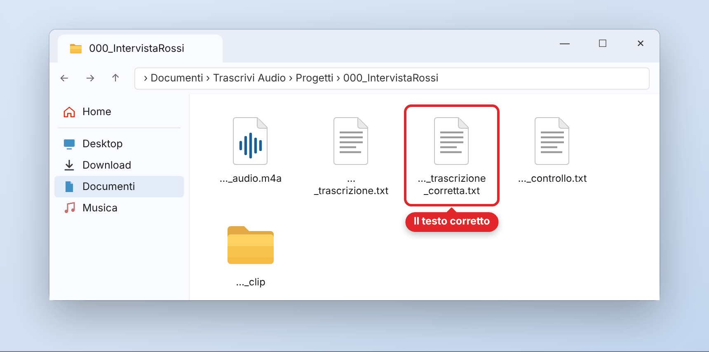{width=88%}\

> Se la cartella **Documenti** è sincronizzata con **OneDrive**, i progetti vengono salvati invece
> in **C:\\Utenti\\*tuo nome*\\Trascrivi Audio**, che OneDrive non sincronizza: così l'audio non
> finisce online. Il messaggio di fine installazione indica la cartella esatta.

## 3. Aprire un progetto esistente

### Passo 1 – Scegli «Apri un progetto»

Fai doppio clic sull'icona **Trascrivi Audio**, scegli **Apri un progetto** e clicca **Avanti**.

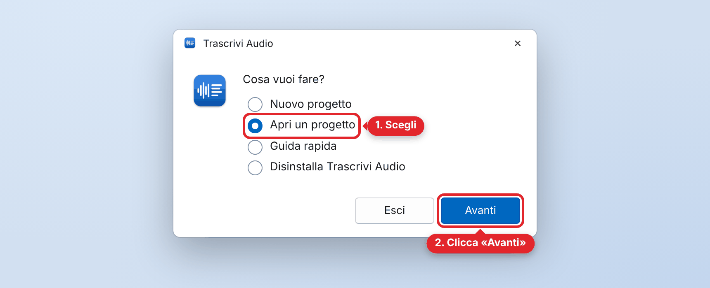{width=88%}\

### Passo 2 – Scegli il progetto

Compare la lista dei progetti: scegli quello che ti serve e clicca **Avanti**. Con più di dieci
progetti la lista diventa un elenco che scorre.

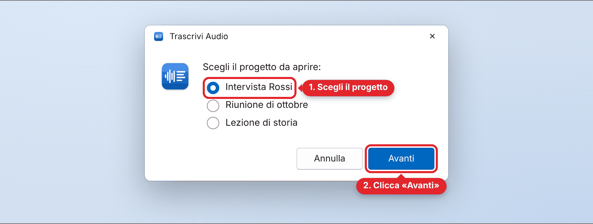{width=88%}\

### Passo 3 – Scegli cosa fare

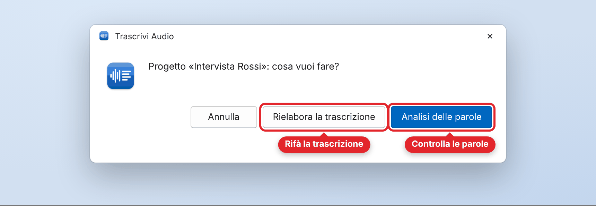{width=88%}\

- **Analisi delle parole**: riapre la schermata di controllo, dalla prima pagina con parole
  ancora da verificare. Le parole già confermate sono verdi e bloccate.
- **Rielabora la trascrizione**: rifà la trascrizione da capo con l'audio del progetto. Prima
  chiede conferma, perché le correzioni fatte in quel progetto si perdono (il tuo dizionario
  personale resta e viene usato).

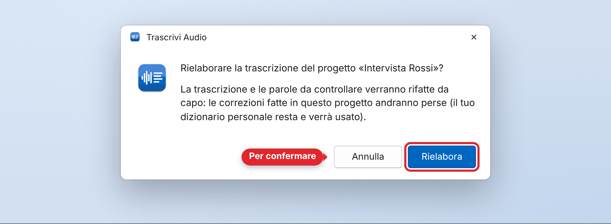{width=88%}\

> Se un progetto non ha ancora una trascrizione completa (per esempio perché era stata
> interrotta), aprendolo la trascrizione riparte da sola. Se manca l'audio, ti viene chiesto.

## 4. Il menu principale e la disinstallazione

Ogni volta che apri **Trascrivi Audio** compare il menu principale. Dopo ogni operazione ci torni.

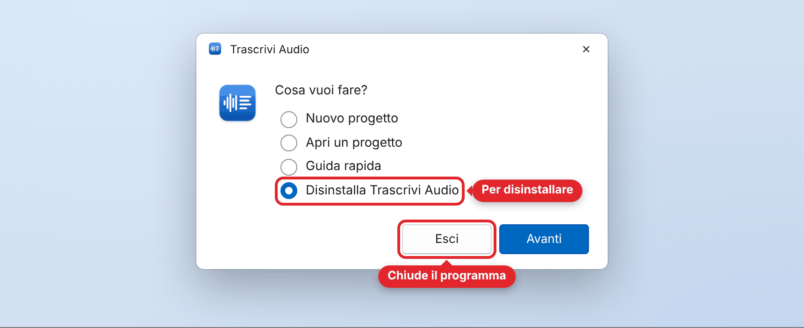{width=88%}\

| Voce del menu | Cosa fa |
|---|---|
| **Nuovo progetto** | crea un progetto e trascrive un file audio (punto 2) |
| **Apri un progetto** | riapre un progetto: analisi delle parole o nuova trascrizione (punto 3) |
| **Guida rapida** | apre questa guida |
| **Disinstalla Trascrivi Audio** | toglie il programma dal computer (vedi sotto) |
| **Esci** | chiude il programma e la finestra di PowerShell |

### Disinstallare

Nel menu scegli **Disinstalla Trascrivi Audio** e clicca **Avanti**. Poi scegli:

- **Conserva i progetti**: toglie il programma ma lascia audio e trascrizioni;
- **Cancella anche i progetti**: toglie tutto. Prima chiede ancora una conferma.

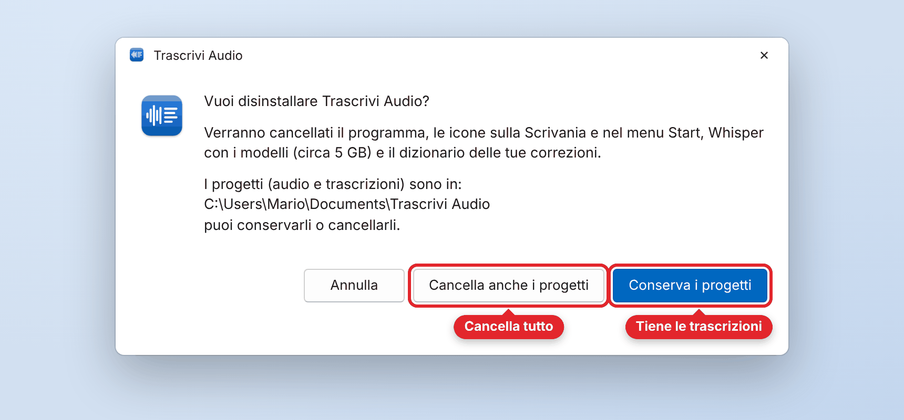{width=88%}\

In entrambi i casi vengono tolti il programma, le icone sulla Scrivania e nel menu Start, Python,
Whisper, i modelli e il dizionario delle tue correzioni.

Puoi disinstallare anche come le altre app: **Impostazioni › App › App installate**, poi **···**
accanto a «Trascrivi Audio» → **Disinstalla**. Compare la stessa finestra di scelta.

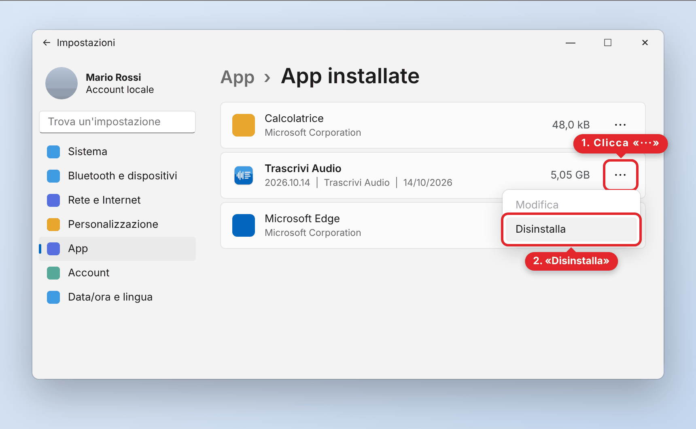{width=88%}\

## 5. Dettagli sul funzionamento

### 5.1 Cosa fa l'installazione

| Cosa | Dove | Note |
|---|---|---|
| Il programma | `%LOCALAPPDATA%\Programs\Trascrivi Audio` | la cartella dei programmi del tuo utente: nessuna richiesta di amministratore. Lavora sempre da lì |
| Python | `%LOCALAPPDATA%\TrascriviAudio\python` | una copia **solo per Trascrivi Audio** (Python 3.12 portatile, circa 44 MB): non interferisce con altri programmi. Il file scaricato viene verificato con la sua impronta di sicurezza (SHA-256) |
| Componenti Microsoft | dentro la copia di Python | le librerie Visual C++ che servono a Whisper (pacchetto msvc-runtime): non vengono installate in Windows |
| Whisper | `%LOCALAPPDATA%\TrascriviAudio` | circa 300 MB |
| Modelli large-v3 e medium | `%LOCALAPPDATA%\TrascriviAudio\modelli` | circa 4,5 GB, scaricati una volta sola |
| Icone | Scrivania e menu Start | aprono il programma |
| Voce in «App installate» | Impostazioni › App | per disinstallare come le altre app |
| Cartella dei progetti | Documenti › Trascrivi Audio | con una copia di questa guida (oppure fuori da OneDrive, vedi 5.2) |

**L'audio non viene mai inviato online**: internet serve solo per scaricare, una volta, Python,
Whisper e i modelli. Durante la trascrizione il programma non si collega a internet. Il
programma lavora in una finestra di PowerShell che mostra cosa sta facendo.

### 5.2 I progetti e i loro file

Ogni progetto ha un **nome** scelto da te e un **numero** da 000 a 999 assegnato dal programma.
La sua cartella si chiama con numero e nome senza spazi (es. `000_IntervistaRossi`) e contiene:

| File | Cosa contiene |
|---|---|
| `…_audio.m4a` (o .mp3, .wav…) | una **copia** del file audio sorgente |
| `…_trascrizione.txt` | la trascrizione automatica |
| `…_trascrizione_corretta.txt` | la trascrizione con le tue correzioni, aggiornata a ogni salvataggio |
| `…_controllo.txt` | il file delle parole dubbie, letto e aggiornato dalla schermata di controllo |
| `…_dati.json` | dati tecnici della trascrizione: non spostarlo e non rinominarlo |
| `…_clip` (cartella) | un ritaglio audio per ogni parola dubbia |

Nella cartella **Progetti** ci sono anche due file gestiti dal programma:

- `elenco-progetti.json`, il **file generale**: per ogni progetto numero, nome, cartella, stato e
  lista di tutti i suoi file;
- `progetto-in-corso.json`, file **temporaneo** con il progetto su cui stai lavorando: viene
  cancellato quando l'operazione finisce.

**Dove sta la cartella dei progetti:** in **Documenti › Trascrivi Audio**. Se però Documenti è
sincronizzata con **OneDrive** (succede spesso su Windows 11), il programma usa
**C:\\Utenti\\*tuo nome*\\Trascrivi Audio**, che OneDrive non sincronizza, perché l'audio non deve
finire online. La scelta si fa alla prima installazione e poi resta sempre la stessa. Se attivi
il backup di OneDrive più tardi, Windows sposta in OneDrive anche i progetti: alla prima apertura
successiva il programma li riporta in **C:\\Utenti\\*tuo nome*\\Trascrivi Audio** e te lo dice.

### 5.3 Come funziona la trascrizione

Il programma usa **Whisper**, un sistema di riconoscimento vocale che lavora solo sul tuo computer.
Ogni audio viene ascoltato più volte, da due modelli diversi, per scoprire dove la trascrizione
potrebbe essere sbagliata.

| Ascolto | Cosa succede |
|---|---|
| 1° – modello **large-v3** | trascrive tutto l'audio e dà a ogni parola un punteggio di **sicurezza** |
| 2° – modello **medium** | ritrascrive tutto l'audio, come seconda opinione |
| Confronto | una parola è **dubbia** se large-v3 non ne è sicuro **oppure** se i due modelli hanno sentito cose diverse |
| 3° – riascolto con large-v3 | ritaglia solo le frasi con parole dubbie e le fa riascoltare. Se ora sente la stessa cosa di medium, il dubbio è risolto |
| 4° – riascolto con medium | dove ancora non coincidono, medium riascolta. Se coincide con il riascolto di large-v3, il dubbio è risolto; altrimenti la parola **resta da verificare** |
| Il tuo dizionario | quando una parola è di nuovo dubbia: se l'avevi corretta viene sistemata da sola, se l'avevi confermata non viene più segnata. Le parole brevi come e/è, a/ha, o/ho e le coppie come anno/hanno restano invece da controllare, perché dipendono dalla frase. Le parole di cui Whisper è sicuro non vengono mai cambiate |

Per ogni parola che resta dubbia, il programma salva un **ritaglio audio** con 3 secondi prima e
3 dopo. Nei file di testo le parole dubbie sono segnate così:

- `*parola*`: da controllare;
- `**parola**`: da controllare per prima, perché i dubbi sono due (sicurezza bassa e modelli in disaccordo).

**Tempi:** da 1 a 3 volte la durata dell'audio su un computer recente; di più sui computer meno
potenti, perché Whisper usa il processore. Mentre il programma lavora il PC non va in stop da solo;
se chiudi il coperchio del portatile, però, si ferma anche la trascrizione.

### 5.4 La schermata di controllo

La schermata si apre nel **browser** (Edge, Chrome o quello predefinito) ma funziona **solo sul
tuo computer**: non usa internet e non è raggiungibile da altri computer.

{width=78%}\

| Parte | A cosa serve |
|---|---|
| In alto | nome dell'audio, conteggi (da verificare, confermate, totale), **Apri trascrizione corretta**, **Chiudi** |
| Ogni riga | numero e orario, frase con la parola evidenziata in giallo, cosa hanno sentito i vari ascolti, lettore del ritaglio e link «Apri l'audio», campo della parola, casella **Confermata** |
| In fondo | numeri di pagina (10 parole per pagina; ✓ = pagina completata), **Salva** e **Annulla** |

| Pulsante | Cosa fa |
|---|---|
| **Salva** | scrive le modifiche nel file delle parole dubbie, aggiorna la **trascrizione corretta**, registra le parole nel tuo **dizionario personale** (correzioni e conferme) e salva gli esempi audio. Poi **ricarica il file**: le parole confermate restano bloccate per sempre |
| **Annulla** | scarta le modifiche non ancora salvate e mostra di nuovo il contenuto del file |
| **Chiudi** | chiude la schermata e torna al menu principale. Se ci sono modifiche non salvate, avvisa. Se chiudi la scheda del browser senza «Chiudi», dopo pochi secondi si torna comunque al menu |

- Una parola modificata ma **non** confermata viene salvata come bozza: resta tra asterischi e
  potrai confermarla più tardi.
- **Cosa vuol dire "registrare" una parola:** Whisper non viene riaddestrato, ma il programma
  ricorda le tue scelte nel **dizionario personale**, comune a tutti i progetti. Nelle trascrizioni
  successive le parole corrette vengono suggerite a Whisper e, dove sono di nuovo dubbie,
  sistemate da sole (tranne le parole brevi come e/è, che dipendono dalla frase); quelle
  confermate non vengono più segnate.

### 5.5 Aggiornare il programma

Scarica il nuovo **TrascriviAudio-Windows.zip**, estrailo (Passo 1 dell'installazione) e fai
doppio clic su **Installa Trascrivi Audio**. Il programma viene sostituito e compare
«Aggiornamento completato». Progetti, dizionario, Python, Whisper e modelli restano.

### 5.6 Problemi frequenti

| Problema | Soluzione |
|---|---|
| «Windows ha protetto il PC» | clicca **Ulteriori informazioni** → **Esegui comunque** (Passo 3 dell'installazione) |
| Il doppio clic su «Installa Trascrivi Audio» dentro lo ZIP non funziona | lo ZIP va prima estratto: tasto destro → **Estrai tutto** (Passo 1) |
| L'antivirus blocca l'installazione | il programma scarica Python e Whisper da internet: alcuni antivirus lo segnalano per prudenza. Consenti l'esecuzione o chiedi a chi ti assiste |
| «Trascrivi Audio non può funzionare su questo PC: i criteri di sicurezza…» oppure «Python portatile installato ma non si avvia» | Windows blocca i programmi senza firma digitale: succede con il **Controllo intelligente delle app** (Smart App Control) attivo o sui PC aziendali. Si può disattivare in Sicurezza di Windows › Controllo delle app e del browser › Impostazioni di Controllo intelligente delle app (poi non si riattiva senza reinstallare Windows): se non sei sicuro, chiedi a chi ti assiste |
| «Download di Python non riuscito» o «non è integro» | controlla la connessione a internet e riapri Trascrivi Audio |
| Ho chiuso la finestra di PowerShell | il programma si interrompe: riaprilo dall'icona. Se stava trascrivendo, apri il progetto: la trascrizione riparte |
| Non trovo più l'icona sulla Scrivania | cerca «Trascrivi Audio» nel menu **Start**; per rimettere l'icona, trascinala dal menu Start alla Scrivania |
| «La cartella del progetto non esiste più» | se l'hai spostata o rinominata, rimettila in Trascrivi Audio › Progetti con il nome originale; se l'hai cancellata, scegli **Togli dall'elenco** |
| «Trascrivi Audio è già aperto in un'altra finestra» | il programma si può aprire una volta sola: continua dalla finestra di PowerShell già aperta (la trovi sulla barra delle applicazioni). Per aggiornarlo o disinstallarlo, prima chiudilo con **Esci** |
| «Il file … non è un audio leggibile» o «non contiene audio» | il file è rovinato, non è un audio o è un video senza audio: scegline un altro |
| «Nell'audio non è stato riconosciuto nessun parlato» | il file è muto o non è quello giusto: crea un nuovo progetto con il file giusto |
| «La trascrizione non è riuscita» | il programma torna al menu; il motivo è scritto nella finestra di PowerShell. Puoi riprovare da **Apri un progetto** |
| La schermata di controllo non si apre | nella finestra di PowerShell c'è l'indirizzo da copiare nel browser |
| L'audio di una riga non parte | usa il link «Apri l'audio» sotto il lettore |
| Una parola non deve più essere considerata confermata | cancella la sua riga da `dizionario.txt` (vedi 5.7) |
| Qualcosa va storto | la finestra di PowerShell resta aperta con l'errore: copiane il testo e invialo a chi ti assiste |

### 5.7 Dove sono i dati

- **Programma:** `%LOCALAPPDATA%\Programs\Trascrivi Audio`.
- **Progetti e guida:** Documenti › Trascrivi Audio (o `C:\Utenti\tuo nome\Trascrivi Audio` se
  Documenti è sincronizzata con OneDrive).
- **Dati del programma:** `%LOCALAPPDATA%\TrascriviAudio` (in Esplora file incolla il percorso
  nella barra dell'indirizzo). Contiene:
  - `python\` e `modelli\`: Python con Whisper e i modelli;
  - `dizionario.txt`: le tue correzioni e conferme, una per riga («sbagliata → giusta»). Puoi
    modificarlo a mano (al posto di → puoi scrivere ->): le righe che cancelli non ricompaiono;
  - `esempi\`: gli audio corretti, con il testo giusto.

Per disinstallare usa la voce **Disinstalla Trascrivi Audio** del menu, oppure Impostazioni ›
App › App installate (punto 4): toglie tutto da solo.
